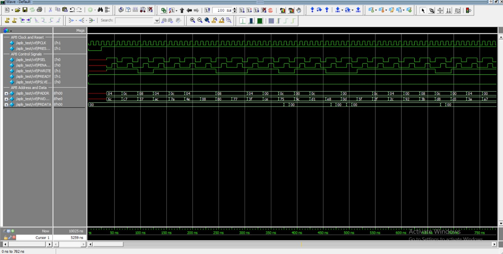

# APB Protocol Verification Using SystemVerilog (Without UVM)

## 1. Project Overview

This project implements a verification environment for an AMBA APB (Advanced Peripheral Bus) slave using SystemVerilog and a class-based testbench, without using the UVM framework.

The testbench verifies read and write transactions, checks returned data against a reference model, applies protocol assertions, and measures functional coverage.

## 2. Project Objectives

- Understand and verify the APB protocol.
- Generate randomized read and write transactions.
- Drive APB signals through a virtual interface.
- Monitor completed transfers.
- Compare read data against a scoreboard reference model.
- Check protocol behavior using SystemVerilog Assertions.
- Measure functional coverage across read/write operations and addresses.

## 3. Verification Architecture

The testbench consists of the following components:

- **Transaction:** Stores randomized operation, address, write data, and observed read data.
- **Generator:** Creates randomized APB transactions.
- **Driver:** Drives setup and access phases on the APB interface.
- **Monitor:** Observes bus activity and collects transaction information.
- **Scoreboard:** Maintains a reference memory model and compares expected and actual read data.
- **Environment:** Instantiates and connects the verification components using mailboxes.
- **Assertions:** Check selected APB protocol requirements.
- **Functional Coverage:** Measures read/write operations and address combinations.

### Verification Flow

```text id="8p2zbx"
Randomized Transactions
          |
          v
       Generator
          |
          v
        Mailbox
          |
          v
         Driver
          |
          v
       APB Slave
          |
          v
        Monitor
          |
          v
        Mailbox
          |
          v
      Scoreboard <---- Reference Model
          |
          v
 Expected vs Actual
          |
          v
       PASS / FAIL
```

## 4. Design Under Test

The APB slave contains four 8-bit registers mapped to these addresses:

| Address | Register |
|---|---|
| `0x00` | Register 0 |
| `0x04` | Register 1 |
| `0x08` | Register 2 |
| `0x0C` | Register 3 |

The slave supports register reads and writes, provides a ready response, and indicates invalid addresses through `PSLVERR`.

## 5. Simulation Results

Simulation was performed using QuestaSim 10.7c.

| Metric | Result |
|---|---:|
| Observed transactions | 100 |
| Successful read comparisons | 37 |
| Read mismatches | 0 |
| Reported functional coverage | 100% |

**Note:** The scoreboard's PASS counter counts successful read comparisons only. Writes update the reference model but do not increment PASS. Functional coverage represents the bins defined in this testbench.

## 6. Simulation Waveform

The waveform displays the clock, reset, APB control signals, address, write data, and read data.



[**View Full-Size APB Waveform**](APB_Verification_waveform.jpeg)

## 7. Tools and Technologies

- SystemVerilog
- QuestaSim 10.7c
- Class-Based Verification
- SystemVerilog Assertions (SVA)
- Functional Coverage
- Mailbox-Based Communication
- Scoreboard-Based Checking
- GitHub

## 8. Key Learning Outcomes

- Building a modular class-based verification environment without UVM.
- Understanding APB setup and access phases.
- Using mailboxes for communication between testbench components.
- Implementing a reference model and scoreboard.
- Writing protocol assertions and functional coverage.
- Analyzing simulation logs and waveforms.

## 9. Future Improvements

- Add directed tests for invalid addresses and error responses.
- Improve transaction completion and end-of-test synchronization.
- Extend protocol assertions and coverage goals.
- Compare this approach with a separate APB UVM verification environment.

## Author

**Kethana Rakshitha**

Electronics and Communication Engineering Student | VLSI Design Verification

GitHub: [kethana-rakshitha](https://github.com/kethana-rakshitha)
